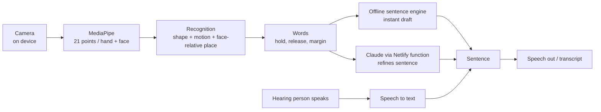

# SignBridge

**Two-way Indian Sign Language ↔ speech interpreter that runs in your browser.**
Sign into a webcam and get a spoken sentence. The other person speaks and you read it. Nothing to install, and video never leaves the device.

> **Status: working prototype / hackathon demo.** The 100 signs are a *designed demo vocabulary*, not the official ISLRTC dictionary, and every test uses simulated hands. There is no real-world accuracy figure yet. See [docs/SOLID_VS_UNTESTED.md](docs/SOLID_VS_UNTESTED.md).

## Try it
- **Live:** open the deployed Netlify link (HTTPS gives camera and microphone access).
- **Locally:** open `dist/index.html` in Chrome and allow the camera. No server needed.
- Follow the 2-minute script in [docs/DEMO_SCRIPT.md](docs/DEMO_SCRIPT.md): HELLO → ME → HELP.

## What it does
| Area | Features |
|---|---|
| **Recognizing** | MediaPipe hands + face; rotation-independent finger analysis; location relative to the signer's own face; motion; 20-second personal calibration; top-3 candidates; **Recognition lab** with live finger states and scores; central-person-only signer selection (bystanders ignored) |
| **Understanding** | Words, per-word confidence, runner-up candidates, last 5 turns and the hearing person's reply go to Claude; returns sentence, intent, alternative reading and doubtful words; **Explain my reading**; offline engine as instant draft and fallback |
| **Teaching** | Learn a sign with live per-finger coaching, practice game (score/streak), teach-a-sign with collision check, test and delete, sign pack export/import |
| **Sentence** | Tense, questions, negation, politeness; casual/formal; English, Hindi, Telugu, Tamil; browser text-to-speech; transcript with copy/clear |
| **Interface** | Two-panel layout, light/dark, onboarding, Demo mode, Judge view (architecture and live stats), basic human check, optional Google reCAPTCHA |

## Architecture

Camera frames are processed in the browser and are never uploaded. Only recognised words and small metadata (confidence, zone, motion), recent turns and the reply text reach the AI function.

## Repository layout
```
index.src.html          UI (HTML/CSS) and glue script: camera loop, screens, state
engine.js               face frame and zones, signer selection, phrases, tone, offline sentences
hands.js                finger states, handshape, hand tracker, motion, calibration
lexicon.js              the 100 demo signs as data, matcher, n-best smoothing
learn.js                teach-a-sign, coaching, practice game, sign packs
ai-core.js              Claude prompts, tool schema, payload cleaning (shared by browser and server)
netlify/functions/      fluent.mjs: the only server code (calls Claude; key stays server-side)
build.mjs               inlines the modules into dist/index.html (+ _headers)
dist/                   built single-file site: this is what gets deployed
test/                   unit tests (Node) and e2e.cjs (Playwright with a fake camera)
docs/                   demo script, pitch cheat sheet, code tour, honest status, notices
```
More detail: [docs/CODE_TOUR.md](docs/CODE_TOUR.md).

## Develop
```bash
node build.mjs          # rebuild dist/index.html from the sources
npm test                # unit tests: engine, AI (mocked Claude), learn/coach/packs, hands, lexicon, metrics
npm run e2e             # build + browser tests (needs Playwright and Chromium)
```
No dependencies are needed to build or run the unit tests (Node 18+).

## Deploy (Netlify)
- **Site only:** drag the contents of `dist/` (`index.html` and `_headers`) into Netlify → *Deploy manually*. Works with the offline engine.
- **With the Claude function:** Netlify's drag-and-drop does not deploy functions. Use Git-based deploys or the CLI: `netlify deploy --prod --dir=dist --functions=netlify/functions`, then set `ANTHROPIC_API_KEY` (and optionally `SIGNBRIDGE_MODEL`) in the site's environment variables.
- **Without a server function:** a person can paste their own API key into the app's AI settings; it is stored only in that browser.
- **Google reCAPTCHA (optional):** put your public site key in `RECAPTCHA_SITE_KEY` in `index.src.html`, then `node build.mjs`. Without a server-side token check this gates the interface only.

## Honest scope
- Demo vocabulary, not official ISL. Teach-a-sign and sign packs are the path to the real signs.
- Verified with simulated hands and a fake camera only. Real lighting, skin tones, cameras and crowds are untested.
- Hindi/Telugu/Tamil speech depends on voices installed in the browser; speech-to-text uses the browser's own service.
- Not a replacement for human interpreters.

## Credits and license
© 2026 SignBridge Team. All rights reserved (see [LICENSE](LICENSE)). Hand and face tracking by [Google MediaPipe](https://ai.google.dev/edge/mediapipe) (Apache 2.0); font DM Sans (SIL OFL 1.1); AI sentences by Claude (Anthropic). Details: [docs/THIRD_PARTY_NOTICES.md](docs/THIRD_PARTY_NOTICES.md).
